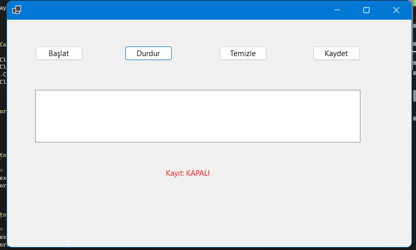
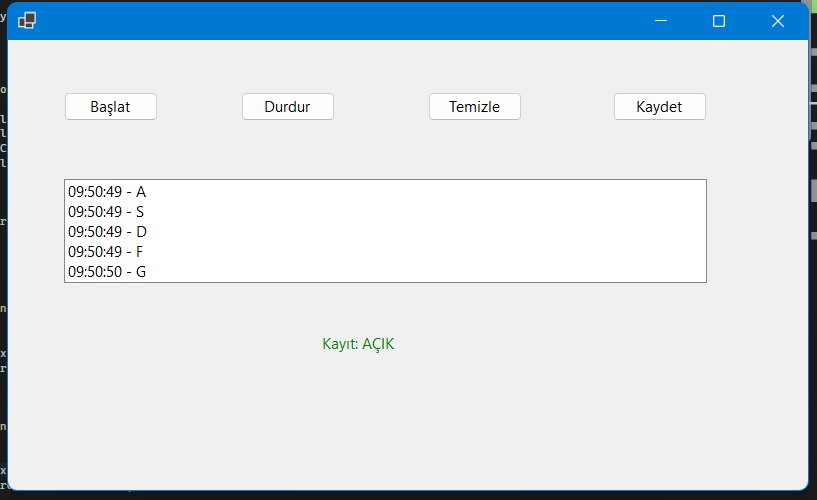

# YMH219-KeyEventLogger

Windows Forms ile geliştirilmiş eğitsel bir klavye olay kaydedicisi. Uygulama yalnızca kendi penceresi aktifken basılan tuşları ve zamanını listeler, isteğe bağlı olarak .txt dosyasına kaydeder.

Bu gerçek bir keylogger değildir. Sadece kendi penceresi aktifken çalışır, arka planda çalışmaz ve hiçbir veriyi başka yere göndermez.

## Kullanılan Teknolojiler
- C# ve .NET (Windows Forms)
- Visual Studio
- Git ve GitHub

## Kurulum ve Çalıştırma
1. Repoyu bilgisayarına klonla: `git clone https://github.com/silaakdemiir/YMH219-KeyEventLogger.git`
2. `YMH219-KeyEventLogger.slnx` dosyasını Visual Studio ile aç.
3. F5 tuşuna basarak uygulamayı çalıştır.

## Temel Özellikler
- **Başlat:** Tuş kaydını açar, durum yazısı yeşil "Kayıt: AÇIK" olur.
- **Durdur:** Tuş kaydını kapatır, durum yazısı kırmızı "Kayıt: KAPALI" olur.
- **Temizle:** Listedeki tüm kayıtları siler.
- **Kaydet:** Listedeki kayıtları seçtiğim bir .txt dosyasına yazar. Liste boşsa uyarı verir, dosyaya yazarken hata olursa uygulama kapanmaz, hata mesajı gösterir.
- Kayıt açıkken basılan her tuş `saat - tuş adı` biçiminde listeye eklenir.

## Ekran Görüntüleri
Kayıt kapalıyken:

Kayıt açıkken:

## Bilinen Sınırlamalar ve Notlar
- Tuşlar sadece uygulama penceresi aktifken yakalanır.
- Formun `KeyPreview` özelliğini açmam gerekti. Açmayınca butonlar odaktayken tuşları form görmüyordu.
- Başlat butonuna basınca buton odağı alıyor. Sonra Enter veya Boşluk tuşuna basılırsa buton tekrar çalışabilir, bu yüzden denerken harf tuşlarını kullandım.
- Kayıtlar sadece Kaydet butonuna basıldığında dosyaya yazılır, otomatik kaydedilmez.

## Öğrenci
Sıla Akdemir - 260541319
